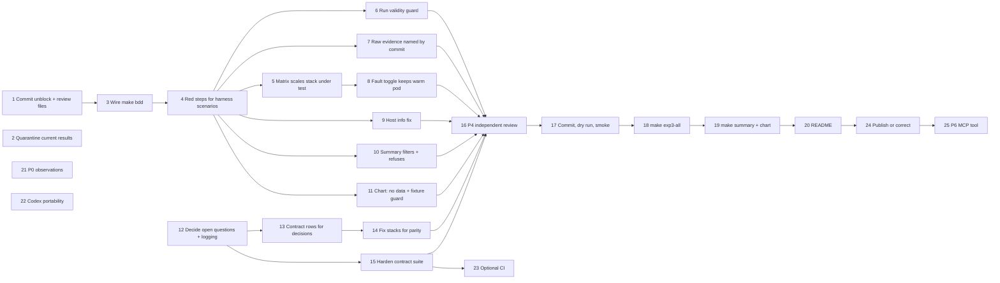

# TASKS — book-review (wcf-physics-agentic)

Status of `rajchampaneriya/book-review` at commit `ac41f49` (10 Oct 2026), reviewed 15 Oct 2026.

The repo holds **one experiment**: Experiment 3, "a retry is not a resend" (`docs/exp3-spec.md`), built as 3 stacks × 2 variants (naive control, idempotency-keyed treatment) × 3 fault rates × 3 runs, and delivered in phases P0–P6 (`prompts/`). Items are grouped by the part of that experiment they belong to. Status comes from evidence in the repo; "run here" means I executed it in this review, and anything else is read from files or commit history. The repo has no TODO or FIXME comments, no open-issue data reachable from here, and no notebooks, so the evidence is code, data, history and missing files.

Each item has acceptance criteria as one Gherkin scenario, written to the same standards as `docs/review/BDD_REVIEW.md`. The architecture diagram is `docs/review/architecture.excalidraw`.

---

## ▶ Execution sequence

Do these in order. Steps on the same row of the diagram can run in parallel. The order follows one rule: **every change that can affect a measurement lands before the single, expensive rerun**, and the fresh-eyes review (P4) happens just before that rerun, as `prompts/04-independent-review.md` intends. Because the matrix resumes by git commit, the rerun after these fixes repeats all 54 runs, .NET included, so it happens once.

"You" means the author: CLAUDE.md reserves the spec, `CLAUDE.md`, `tools/arch/` and every decision for you, and `results/` is written only by the harness. "Agent" means a Claude Code session working under CLAUDE.md. Each step's acceptance criteria are the Gherkin scenario of the task named in **Done when**.



### Stage 0 · Contain (today)

1. **Review and commit the unblocking change and the review files.** You. Needs nothing. *In progress:* branch `review/bdd-structure-gate` holds the review files; apply `protected-changes.patch` there for the CLAUDE.md, AGENTS.md and `tools/arch/` part.
   Check: `python3 tools/arch/check_hexagonal.py --all` passes and `python3 tools/arch/selftest.py` reports 114/114.
   Done when: *Review and BDD files are allowed by the structure gate*.
2. **Quarantine `figures/exp3_duplicates.svg` and `results/exp3/summary.csv`.** You. Needs nothing. Don't publish them; if a post already uses them, plan a correction.
   Done when: *Has anything been published from the current results?* is answered.

### Stage 1 · Make the BDD layer runnable, red first

3. **Pin `pytest-bdd==9.0.0` in `requirements-host.txt` and `versions.md`, and add a `make bdd` target.** Agent; you add the target to the CLAUDE.md commands table. Needs 1. *In progress:* done on the branch; the commands-table row is in the protected patch.
   Check: `make doctor && make bdd` → 5 passed, 4 failed; each failure names a known defect.
   Done when: *Adopt the BDD layer*.
4. **Add steps for the remaining harness, summary and chart scenarios, and watch them fail for the right reason.** Agent. Needs 3.
   Check: `make bdd` lists every scenario in `bdd/features/exp3_measurement_run.feature` and `exp3_results_summary_and_chart.feature`.
   Done when: *Add tests for the harness*.

### Stage 2 · Fix the harness, one scenario at a time

5. **Scale the stack under test to 1 and wait for its rollout before the warm-up.** Agent. Needs 4. File: `harness/exp3_matrix.py:115-121`.
   Done when: *Scale the stack under test to 1 and wait until it serves*.
6. **Refuse to append a run with zero bookings, any lost request or any dropped iteration.** Agent. Needs 4. File: `harness/exp3_run.py:75-117`.
   Done when: *Refuse to record a run that failed*.
7. **Put the commit in raw evidence file names.** You change the name pattern in `docs/exp3-spec.md:135`; the Agent changes `harness/exp3_run.py:55`. Needs 4.
   Done when: *Name raw evidence files by commit*.
8. **Turn fault injection on once per stack, before its warm-up, instead of before every run.** You choose the design; the recommended option keeps the deployment default off for contract test 8 and enables it in the matrix only. Agent implements. Needs 5. Files: `harness/exp3_run.py:37-42`, `harness/exp3_matrix.py`.
   Check: a fault-0 smoke run shows no status-0 attempts.
   Done when: *Turn on fault injection without restarting the warmed-up pod*.
9. **Fix host details.** Agent. Needs 4. File: `harness/hostinfo.py:26-44`.
   Done when: *Fix host details on every host OS*.
10. **Make the summary use one commit and full-length runs, and refuse invalid runs.** Agent; you add one sentence to `docs/exp3-spec.md:162-164`. Needs 4. File: `harness/exp3_summary.py:34-49`.
    Done when: *Filter the summary to one commit and full-length runs, and refuse invalid runs*.
11. **Draw missing groups as "no data", and refuse the synthetic fixture as input for the published chart.** Agent. Needs 4. File: `figures/exp3_duplicates.py:57-68`.
    Done when: *Show missing groups as "no data", and refuse the fixture as published input*.

### Stage 3 · Stack parity and fairness (can run alongside Stage 2)

12. **Decide the five open questions and write the answers into the spec.** You. Needs nothing. Key-versus-body precedence, empty strings, field-name case, fractional deposits, and per-request logging during measured runs.
    Done when: each of the five matching Open Questions below has its scenario agreed.
13. **Add the decided cases to the contract tests and promote the `@open-question` rows in `bdd/features/`.** Agent. Needs 12. Expect them to fail on the divergent stacks.
    Done when: *The stacks pass the same contract tests but disagree on untested inputs*, still red.
14. **Change the stacks, never the tests (rule G8).** Agent. Needs 13. .NET: read the body before the key, apply the agreed string and case rules, log in-flight with `ILogger`. Java: refuse fractional deposits, and give `BookingRequest` its own `toCommand()` so the v2 controller stops calling the naive controller (no new file needed). Python: match the logging decision.
    Check: `make unit`, `make arch`, `make deploy` and `make contract` for each stack.
    Done when: *The stacks pass the same contract tests but disagree on untested inputs* is green, plus *Test the in-flight mapping and make it visible in .NET logs*.
15. **Harden the contract suite inside its existing files.** Agent. Needs 12. Per-request client references instead of `TRUNCATE`, the request-key outline, conflict over all five fields plus charges, the fault-on test (run with injection enabled), and Postgres atomicity.
    Done when: *Make contract tests independent of shared tables*, *Cover request-key rules, every hashed field and charges in the conflict test*, *Test the fault hook's "on" path*, *Test atomicity against Postgres, not only the in-memory store*.

### Stage 4 · Review once, then measure once

16. **Run P4, the independent review, in a fresh session on the fixed code; fix anything critical.** You, with a new Agent session. Needs 6–11, 14 and 15.
    Done when: *Was P4, the independent review, done, and where are its findings?*
17. **Commit, then dry-run and smoke-test.** You. Needs 16.
    Check: `make exp3-all DRY_RUN=1` plans 54 runs and 3 warm-ups for the new commit; a `TOTAL=500` smoke run with `RUN=9` on java and python records bookings, and the summary leaves it out.
18. **Run the full matrix.** You, on the measurement Mac. Needs 17. Roughly 95 minutes plus rollouts at the defaults.
    Check: every row for the commit has bookings ≥ logical requests, `lost = 0`, `dropped_iterations = 0`, and status-0 attempts equal to the faulted count.
    Done when: *Full 54-run matrix — only 18 of 54 runs are valid* and *Re-run the full matrix on the fixed commit*.
19. **Run `make summary` and `make chart`, inspect, then write the chart title.** You. Needs 18.
    Done when: *Regenerate summary.csv and the chart through make after the rerun*, *summary.csv exists but is stale and mixed*, *Published chart is the synthetic fixture*, and *Which commit is the authoritative result set?*

### Stage 5 · Publish readiness

20. **Write the code README (P5).** Agent. Needs 19 for the run times and results.
    Check: `python3 tools/arch/check_hexagonal.py --all --complete` passes.
    Done when: *Write the code README* and *Publish check passes except for the README*.
21. **Record the P0 observations.** You. Needs nothing; do it whenever. Note in each META.md that the model and date differ from the build weekend.
    Done when: *Record the default-output observation per stack*.
22. **Make the Codex configuration portable.** Agent; you edit AGENTS.md if you keep it protected. Needs nothing.
    Done when: *Make the Codex configuration portable*.
23. **Optional: CI running `make contract` per stack and `make bdd`.** Agent. Needs 3 and 15.
    Done when: *Optional CI that runs the contract suite per stack*.
24. **Publish the article, or the correction, with the new chart.** You. Needs 19 and 20.
    Done when: *Has anything been published from the current results?*

### Stage 6 · Stretch

25. **P6, the MCP booking tool.** Agent. Needs 24; its prompt only allows it once Exp 3 is complete.
    Done when: *Expose the booking as an MCP tool reusing the v2 driving port*.

---

## ✅ Done

### Exp 3 · Foundation (spec, rules, guardrails, infra)

- [x] **Experiment spec and agent rules are written and wired in** — `docs/exp3-spec.md`, `CLAUDE.md`, `AGENTS.md`
  - Evidence: the spec defines the HTTP contract, the measurement, the matrix and contract tests 1–8 (`docs/exp3-spec.md:62-191`); `CLAUDE.md:9` imports it.
  ```gherkin
  Scenario: Every contract behaviour in the spec has a matching test
    Given the spec lists contract tests 1 to 8
    When the contract suite is collected
    Then each numbered behaviour has exactly one test that names it
  ```

- [x] **Architecture gate catches every structural and layering violation** — `tools/arch/check_hexagonal.py`, `tools/arch/selftest.py`
  - Evidence: `selftest.py` 114/114 and `check_hexagonal.py --all` passed (run here); all three stack copies of the architecture tests are identical to their templates (diffed here).
  ```gherkin
  Scenario: The gate passes the complete tree and catches every seeded violation
    Given the 114 self-test cases
    When the self-test runs
    Then the complete tree passes and every seeded violation is reported
  ```

- [x] **Agent hooks protect results and the grader** — `.claude/settings.json`, `.claude/hooks/protect-files.sh`, `.claude/hooks/arch-gate.sh`
  - Evidence: PreToolUse and Stop hooks are configured (`.claude/settings.json:6-27`); the protected paths match CLAUDE.md H1 (`protect-files.sh:22-28`). Not exercised here.
  ```gherkin
  Scenario: An agent cannot edit measured results
    Given an agent session at the repo root
    When the agent tries to edit results/exp3/runs.csv
    Then the edit is blocked with a message naming the protected path
  ```

- [x] **Database schema and local cluster** — `db/schema.sql`, `infra/k3d/cluster.yaml`, `infra/k8s/*.yaml`, `infra/scripts/*.sh`
  - Evidence: the schema matches `docs/exp3-spec.md:26-56` line for line; 18 valid .NET runs in `results/exp3/runs.csv` (commit `c433bfe`) were served by this cluster.
  ```gherkin
  Scenario: A clean machine reaches a cluster with one schema per stack
    Given a machine with only the doctor-checked prerequisites
    When the cluster is brought up
    Then Postgres is reachable on host port 55432
    And the dotnet, java and python schemas each hold empty bookings, charges and idempotency_keys tables
  ```

### Exp 3 · Python stack (P1, reference)

- [x] **Hexagonal FastAPI stack with both variants** — `stacks/python/`
  - Evidence: `check_hexagonal.py python` passed; 20/20 unit tests passed on Python 3.14.6 (run here); commit `7a836d6` reports the contract tests green; valid row `478ec4e` for both variants at 5%.
  ```gherkin
  Scenario: The Python stack passes its unit and architecture gates
    Given a clean checkout of stacks/python
    When the stack's unit and architecture stages are built
    Then both stages succeed
    And import-linter reports 5 contracts kept and 0 broken
  ```

### Exp 3 · .NET stack (P2)

- [x] **Hexagonal .NET 10 stack with both variants** — `stacks/dotnet/`
  - Evidence: `check_hexagonal.py dotnet` passed (run here); commit `f76a4af` "contract tests green"; 18/18 valid matrix runs in `runs.csv` (`c433bfe`). Unit and architecture tests not run here (no .NET SDK).
  ```gherkin
  Scenario: The .NET stack passes its unit and architecture gates
    Given a clean checkout of stacks/dotnet
    When the stack's unit and architecture stages are built
    Then both stages succeed
    And NetArchTest reports 6 facts passed
  ```

### Exp 3 · Java stack (P2)

- [x] **Hexagonal Spring Boot 4 stack with both variants** — `stacks/java/`
  - Evidence: `check_hexagonal.py java` passed (run here); commit `4a246ea` "contract tests green"; valid row `4a246ea` for both variants at 5%. Unit and architecture tests not run here (JDK 21 only; Maven Central unreachable).
  ```gherkin
  Scenario: The Java stack passes its unit and architecture gates
    Given a clean checkout of stacks/java
    When the stack's unit and architecture stages are built
    Then both stages succeed
    And ArchUnit reports 5 rules passed
  ```

### Exp 3 · Contract tests

- [x] **Eight cross-stack contract tests** — `contracts/tests/`
  - Evidence: all eight behaviours of `docs/exp3-spec.md:179-191` are implemented; commit messages report them green per stack. Not run here (needs the cluster). Quality gaps are tracked under Not Started.
  ```gherkin
  Scenario: The contract suite passes against every stack
    Given the cluster is up with all three stacks deployed
    When the contract suite runs against each stack in turn
    Then every contract test passes for dotnet, java and python
  ```

### Exp 3 · Measurement

- [x] **Load script and single measured run** — `harness/k6/exp3.js`, `harness/exp3_run.py`, `harness/db.py`
  - Evidence: valid rows for all three stacks at 5% (`478ec4e`, `f76a4af`, `4a246ea`); fault selection puts exactly 100 and 500 of 10 000 first attempts under fault at 1% and 5% (computed here from `exp3.js:59`).
  ```gherkin
  Scenario: One measured run appends one row counted in the database
    Given a serving python stack with empty tables
    When one naive run at a 5% fault rate completes
    Then exactly one row is appended to the run log
    And its duplicate count equals bookings minus distinct client references
  ```

- [x] **Valid .NET matrix: 18 of 18 runs** — `results/exp3/runs.csv` (`c433bfe`), `results/exp3/raw/dotnet_*.json`
  - Evidence: every dotnet row has `gave_up = 0`, `lost = 0`, duplicates 0 for v2, 99–100 at 1% and 496–500 at 5% for naive.
  ```gherkin
  Scenario: Every dotnet run of the matrix is valid
    Given the dotnet rows of the run log for one commit
    When their validity is checked
    Then all 18 runs have no lost requests and no dropped iterations
  ```

- [x] **Exact versions recorded** — `versions.md`
  - Evidence: host, stack and infra versions with sources; deviations listed (`versions.md:73-97`).
  ```gherkin
  Scenario: The recorded versions match what each stack builds
    Given versions.md
    When each stack's build files are compared with it
    Then every pinned runtime, framework, driver and image tag appears in versions.md with the same version
  ```

### Exp 3 · Chart

- [x] **Chart script and its fixture test** — `figures/exp3_duplicates.py`, `figures/tests/test_exp3_duplicates.py`
  - Evidence: the test passed with matplotlib 3.11.2 (run here). The published chart itself is under In Progress.
  ```gherkin
  Scenario: The chart is drawn from a summary into a chosen location
    Given the labelled synthetic summary
    When the chart is drawn into a temporary folder
    Then the chart shows all three stacks with every bar labelled
    And nothing under results/ or figures/ changes
  ```

---

## 🚧 In Progress

### Exp 3 · Measurement

- [ ] **Full 54-run matrix — only 18 of 54 runs are valid** — `harness/exp3_matrix.py:115-121`, `results/exp3/runs.csv`
  - Evidence: all 36 java and python rows for `c433bfe` have `bookings_total = 0`, `timeouts = attempts = 3 × logical` and `lost = logical`; raw summaries show `http_req_failed` = 1.0 and a 999.9 ms median (the 1 s timeout). Cause, reproduced here with stubs and with a failing BDD scenario: the loop scales the other stacks to 0 but never scales the stack under test back to 1.
  ```gherkin
  Scenario: The full matrix records only valid runs
    Given the matrix has run all 54 runs on one commit
    When the run log for that commit is checked
    Then all 54 runs recorded at least as many bookings as logical requests
    And no run lost a request
  ```

- [ ] **Raw k6 evidence for the early valid rows was overwritten** — `results/exp3/raw/*_f0.05_r1.json`
  - Evidence: commit `ac41f49` replaced the six `*_f0.05_r1.json` files written for the valid rows of `478ec4e`, `f76a4af` and `4a246ea`; the java and python files now hold the failed matrix runs. The originals survive only in git history (`725eaf1`, `6c0e3ca`). Raw file names carry no commit, so every rerun overwrites evidence.
  ```gherkin
  Scenario: Every row in the run log has its own raw evidence
    Given the run log
    When each row's raw summary is looked up
    Then exactly one raw file exists for that row's commit, stack, variant, fault rate and run
  ```

- [ ] **host.json is captured but its OS field is wrong** — `harness/hostinfo.py:36`, `results/exp3/host.json`
  - Evidence: `host.json` reads `"Darwin 27.0.0 (<function machine at 0x1059dbd70>)"`; `platform.machine` is formatted without being called. CPU and memory come from macOS `sysctl` only, so they are blank on Linux.
  ```gherkin
  Scenario: Host details name the machine architecture
    Given the host is an arm64 machine
    When host details are captured
    Then the operating-system entry ends with "(arm64)"
  ```

### Exp 3 · Summary and chart

- [ ] **summary.csv exists but is stale and mixed** — `results/exp3/summary.csv`, `harness/exp3_summary.py:36-38`
  - Evidence: it holds 6 groups from before the matrix; python naive 5% has `runs = 2` with a median of 261, the median of a 500-request smoke run (25) and a full run (497). Rebuilding it from today's run log would report 0 duplicates per 10k for java and python naive at 5% (computed in scratch). A failing BDD scenario reproduces the mixing.
  ```gherkin
  Scenario: The summary covers exactly the full-length runs of one commit
    Given the run log holds full runs, a smoke run and runs from an older commit
    When the summary is built for the measured commit
    Then each group summarises only that commit's 3 full-length runs
  ```

- [ ] **Published chart is the synthetic fixture** — `figures/exp3_duplicates.svg`
  - Evidence: regenerating from `figures/tests/fixtures/exp3_summary_synthetic.csv` gives a file identical to the committed SVG, ignoring the date and generated ids (diffed here). This breaks CLAUDE.md rule H4.
  ```gherkin
  Scenario: The published chart is drawn from the measured summary
    Given a valid summary of the measured commit
    When the published chart is redrawn
    Then every bar's label equals that group's median from the summary
    And no value comes from the synthetic fixture
  ```

### Exp 3 · Cross-stack parity (rule G8)

- [ ] **The stacks pass the same contract tests but disagree on untested inputs** — `stacks/dotnet/src/Rajc.Bookings.Adapters.Inbound.Http/*.cs`, `stacks/java/booking-adapter-in-http/**`, `stacks/python/src/booking/adapters/inbound/http/*.py`
  - Evidence: .NET rejects empty strings (`NaiveBookingEndpoints.cs:55-58`), accepts any field-name case (`InvalidRequestHandling.cs:21`) and checks the key before the body (`BookingEndpoints.cs:22-32`); Python and Java do the opposite on all three. Java's v2 controller reuses the naive controller's mapper, which throws a domain exception for missing strings (`BookingController.java:37`, `NaiveBookingController.java:39-46`).
  ```gherkin
  Scenario Outline: Every stack gives the same answer to the same malformed booking
    Given all three stacks are serving
    When the client sends a keyed booking with <defect> to each stack
    Then all three stacks give the same status and error code

    Examples:
      | defect                         |
      | an empty client reference      |
      | field names in upper case      |
      | an unknown field and no key    |
      | a fractional deposit of 2500.5 |
  ```

### Exp 3 · Review and BDD files

- [ ] **Review and BDD files are allowed by the structure gate** — `CLAUDE.md`, `AGENTS.md`, `TASKS.md`, `docs/review/`, `bdd/`
  - Evidence: on branch `review/bdd-structure-gate`, the review files and `bdd/` are committed; the CLAUDE.md tree entries for them are in the author's protected patch (`protected-changes.patch`), because agents may not edit CLAUDE.md or `tools/arch/`. With the patch applied, `check_hexagonal.py --all` passes and `selftest.py` reports 133/133 (run in a scratch clone).
  ```gherkin
  Scenario: Review and BDD files pass the structure gate without weakening it
    Given TASKS.md, docs/review/ and bdd/ hold the review files
    When the structure check and its self-test run
    Then the structure check passes
    And the self-test still catches every stray file it seeds, 114 of 114
  ```

- [ ] **Adopt the BDD layer** — `bdd/features/*.feature`, `bdd/steps/`, `Makefile`, `requirements-host.txt`
  - Evidence: on branch `review/bdd-structure-gate`, `pytest-bdd` 9.0.0 is pinned (verified on PyPI) and `make bdd` runs `check_hexagonal.py bdd` then the steps; the four scenarios that describe unfixed defects carry `@known-defect` and run as strict expected failures, so the pytest run reports 5 passed, 4 xfailed (run here). `make bdd` needs the `bdd` scope from the author's protected patch.
  ```gherkin
  Scenario: The BDD scenarios run from a fresh host environment
    Given a fresh .venv built by make doctor
    When make bdd runs
    Then every executable scenario in bdd/features is collected and run
  ```

- [ ] **The architecture checker enforces the BDD standards and the AGENTS.md mirror** — `tools/arch/check_hexagonal.py`, `tools/arch/selftest.py`
  - Evidence: written and verified in a scratch clone, delivered as the author's protected patch. New `bdd` scope, also run by `--all`: only `features/*.feature` and `steps/*.py` under `bdd/`; one Feature per file; Background holds context only; 3–7 steps; exactly one When; Given → When → Then ending in Then; Examples for every Scenario Outline; a `@spec-`, `@contract-` or `@rule-` tag. `--all` also fails when AGENTS.md's tree differs from CLAUDE.md's; on `main` today it reports the `.Codex/` drift. `selftest.py` gains 19 cases, 133/133.
  ```gherkin
  Scenario Outline: The checker refuses a feature file that breaks a BDD standard
    Given a feature file with <defect>
    When the whole repo is checked
    Then the check fails and names <rule>

    Examples:
      | defect                               | rule               |
      | two When steps in one scenario       | one action         |
      | eight steps in one scenario          | scenario length    |
      | an outcome before the action         | step order         |
      | no spec, contract or rule tag        | traceability       |
      | a Scenario Outline without Examples  | outline needs examples |
  ```

### Exp 3 · Publish readiness (P5)

- [ ] **Publish check passes except for the README** — `CLAUDE.md:57`
  - Evidence: `check_hexagonal.py --all` passes; `--all --complete` fails only on `README.md` (run here).
  ```gherkin
  Scenario: The publish check passes on a fresh clone
    Given a fresh clone of the repo
    When the complete structure check runs
    Then it reports no violations
  ```

---

## ⬜ Not Started

### Exp 3 · Measurement

- [ ] **Scale the stack under test to 1 and wait until it serves** — `harness/exp3_matrix.py:115-121`
  - Evidence: no `scale(stack, 1)` before `warm_up(stack)`; the BDD outline in `bdd/features/exp3_measurement_run.feature` fails for java and python today.
  ```gherkin
  Scenario Outline: Only the stack under test serves traffic during its runs
    Given the matrix has finished measuring <earlier>
    When the matrix starts measuring <stack>
    Then <stack> has 1 replica
    And every other stack has 0 replicas

    Examples:
      | earlier      | stack  |
      | no stack yet | dotnet |
      | dotnet       | java   |
      | java         | python |
  ```

- [ ] **Refuse to record a run that failed** — `harness/exp3_run.py:75-117`
  - Evidence: rows are appended whatever happened; k6 exits 0 because the script defines no thresholds (`exp3.js:32-44`), so the 36 failed runs were recorded.
  ```gherkin
  Scenario: A run in which no booking was recorded is rejected, not appended
    Given the stack under test answers no requests
    When a measured run completes
    Then the run is reported as invalid
    And no row is appended to the run log
  ```

- [ ] **Re-run the full matrix on the fixed commit** — `results/exp3/`
  - Evidence: depends on the harness fixes; rule H1 forbids editing the invalid rows by hand. The matrix resumes by git commit (`harness/exp3_matrix.py:35-44`), so on the fixed commit all 54 runs repeat, .NET included, which also gives one authoritative commit.
  ```gherkin
  Scenario: Every stack has a complete, valid matrix on one commit
    Given the harness fixes are committed
    When the full matrix runs on that commit
    Then each stack has 18 valid runs in the run log for that commit
  ```

- [ ] **Name raw evidence files by commit** — `harness/exp3_run.py:55`
  - Evidence: `raw_path` is `<stack>_<variant>_f<fault>_r<run>.json`, with no commit, so reruns overwrite earlier evidence.
  ```gherkin
  Scenario: A rerun keeps the earlier run's raw evidence
    Given a raw summary exists for dotnet naive 5% run 1 on commit A
    When dotnet naive 5% run 1 is measured on commit B
    Then the raw summaries of both commits are kept
  ```

- [ ] **Turn on fault injection without restarting the warmed-up pod** — `harness/exp3_run.py:37-42`
  - Evidence: `kubectl set env` changes the pod template, so each measured run starts on a fresh pod and the 60 s warm-up is lost. Every valid .NET run shows 43–73 status-0 attempts that are not explained by faults (for example 43 at fault 0 in `dotnet_naive_f0_r1`), and 1–4 fewer naive duplicates than faulted requests per run. A likely cause is failed connections while the old pod is replaced; that would also swallow faulted requests near the start, such as numbers 0 and 7 at 5% (**assumption**; confirm from pod events).
  ```gherkin
  Scenario: Switching fault injection on keeps the warmed-up process
    Given the stack under test has been warmed up
    When fault injection is switched on for a measured run
    Then the measured run is served by the warmed-up process
    And no attempt fails to connect at the start of the run
  ```

- [ ] **Fix host details on every host OS** — `harness/hostinfo.py:26-44`
  - Evidence: `platform.machine` not called (`:36`); CPU model and memory use macOS `sysctl` only (`:26-32`).
  ```gherkin
  Scenario: Host details are complete on Linux
    Given the harness runs on a Linux host
    When host details are captured
    Then the CPU model, core count and memory are all filled in
  ```

- [ ] **Add tests for the harness** — `harness/`
  - Evidence: no test file exists for `exp3_run.py`, `exp3_matrix.py`, `exp3_summary.py`, `db.py` or `hostinfo.py`. Scenarios and thin steps are in `bdd/features/exp3_measurement_run.feature` and `bdd/steps/`.
  ```gherkin
  Scenario: The harness scenarios run without a cluster
    Given the harness scenarios with kubectl, k6 and Postgres faked
    When they run
    Then they finish in under 10 seconds and all pass
  ```

### Exp 3 · Summary and chart

- [ ] **Filter the summary to one commit and full-length runs, and refuse invalid runs** — `harness/exp3_summary.py:34-49`
  - Evidence: rows are grouped by stack, variant and fault only; no commit, `TOTAL` or validity filter exists.
  ```gherkin
  Scenario: The summary is refused while any run is invalid
    Given the run log holds a run that recorded no bookings
    When the summary is built
    Then the summary is refused and names that run
    And no summary file is written
  ```

- [ ] **Show missing groups as "no data", and refuse the fixture as published input** — `figures/exp3_duplicates.py:57-68`
  - Evidence: a missing group is drawn as a 0 bar labelled `0` (`:60`, `:68`); nothing stops the fixture from reaching `figures/exp3_duplicates.svg`, which is what happened. Both BDD scenarios fail today.
  ```gherkin
  Scenario: A group with no data is shown as missing, not as zero
    Given a summary with no java rows at a 1% fault rate
    When the chart is drawn
    Then the java 1% bars are labelled "no data"
  ```

- [ ] **Regenerate summary.csv and the chart through make after the rerun** — `results/exp3/summary.csv`, `figures/exp3_duplicates.svg`
  - Evidence: both files predate the matrix; the spec requires them to come from `make summary` and `make chart` with no hand edits (`docs/exp3-spec.md:252`).
  ```gherkin
  Scenario: The published numbers come only from make targets
    Given a complete, valid run log for one commit
    When the summary and chart are rebuilt with the make targets
    Then the chart's bars match the summary
    And the summary's groups each cover 3 runs
  ```

### Exp 3 · Contract and BDD tests

- [ ] **Test the fault hook's "on" path** — `contracts/tests/test_fault_hook.py:4-17`
  - Evidence: only the disabled path is tested; the 500 ms check runs on the first request a fresh deployment serves.
  ```gherkin
  Scenario: The fault header holds the confirmation after the booking commits
    Given fault injection is enabled with a 2000 ms hold
    When the client books with the hold-after-commit fault header
    Then the booking is recorded before the confirmation arrives
    And the confirmation arrives no sooner than 2000 ms after the request
  ```

- [ ] **Make contract tests independent of shared tables** — `contracts/tests/conftest.py:39-65`
  - Evidence: every behavioural test truncates the stack's schema, which also wipes any measured run in progress on that stack.
  ```gherkin
  Scenario: Contract tests can run while a measurement is in progress
    Given a measured run is loading the python stack
    When the contract suite runs against the python stack
    Then the measured run's bookings are untouched
    And every contract test passes
  ```

- [ ] **Cover request-key rules, every hashed field and charges in the conflict test** — `contracts/tests/test_v2_bookings.py:9-44`
  - Evidence: only a missing key is tested; only `deposit_cents` varies in the conflict test; charges are not counted there.
  ```gherkin
  Scenario Outline: Reusing a request key for a different booking is refused as a conflict
    Given the client has booked session "s-42" with a fresh request key
    When the client books again with the same request key but a different <detail>
    Then the booking is refused as a request-key conflict
    And still exactly one booking and one deposit charge exist for that request key

    Examples:
      | detail           |
      | client reference |
      | session          |
      | dog              |
      | owner            |
      | deposit amount   |
  ```

- [ ] **Test atomicity against Postgres, not only the in-memory store** — all three `PostgresBookingStore` implementations
  - Evidence: the unit test named "failed transaction leaves nothing behind" fails at the claim, before any write, in all three stacks (`test_book_session_idempotent.py:74-83`, `BookSessionIdempotentServiceTest.java:72-84`, `BookSessionIdempotentServiceTests.cs:72-84`). The rewritten scenario passes on the Python in-memory store (run here).
  ```gherkin
  Scenario: A booking that fails part-way leaves no trace in Postgres
    Given recording the deposit charge will fail once
    When the service books with request key "k1" through the Postgres store
    Then the booking fails
    And no booking, no charge and no claim on request key "k1" remain
  ```

- [ ] **Test the in-flight mapping and make it visible in .NET logs** — `routes_v2.py:66-71`, `BookingEndpoints.cs:42-46`, `BookingController.java:42`, `BookSessionIdempotentService.cs:63`
  - Evidence: no test reaches 409 + `Retry-After`; .NET writes the anomaly with `Trace.WriteLine`, which most likely never reaches container logs (**assumption**).
  ```gherkin
  Scenario: An in-flight outcome tells the client to retry after one second
    Given the booking use case will report request key "k1" as in flight
    When the client books with request key "k1"
    Then the client is told the booking is still in flight and to retry after 1 second
    And the in-flight anomaly appears in the service log
  ```

### Exp 3 · Publish (P5)

- [ ] **Write the code README** — `README.md` (listed at `CLAUDE.md:57`)
  - Evidence: absent; `--all --complete` fails on it (run here); scope is in `prompts/05-readme-and-publish.md:11`.
  ```gherkin
  Scenario: A reader can reproduce the experiment from the README alone
    Given a reader with only the README and the doctor-checked prerequisites
    When they follow the README's commands in order
    Then they reach a passing contract suite for every stack
    And they know how faults are injected and why client_ref exists
  ```

- [ ] **Make the Codex configuration portable** — `.codex/hooks.json:9,19`, `AGENTS.md:57-64`
  - Evidence: hook commands are absolute `/Users/champion.trader/...` paths; AGENTS.md's tree names `.Codex/` while the folder is `.codex/`; the Codex `protect-files.sh` is a copy of the Claude one, so it protects `CLAUDE.md` and `.claude/` but not `AGENTS.md` or `.codex/`.
  ```gherkin
  Scenario: Codex hooks work from any clone location
    Given the repo is cloned to a different path on another machine
    When a Codex session tries to edit AGENTS.md
    Then the protect hook runs and blocks the edit
  ```

- [ ] **Optional CI that runs the contract suite per stack** — `.github/workflows/contract.yml` (optional at `CLAUDE.md:68-70`)
  - Evidence: no `.github/` folder.
  ```gherkin
  Scenario: A pull request shows contract results for every stack
    Given a pull request that changes a stack
    When CI runs
    Then the contract suite result is reported separately for dotnet, java and python
  ```

### Exp 3 · P0 observation

- [ ] **Record the default-output observation per stack** — `observations/exp3/<stack>/` (listed at `CLAUDE.md:82-83`)
  - Evidence: `observations/` does not exist; `prompts/00-observation.md` says article section 6 depends on it.
  ```gherkin
  Scenario: Each stack's default output is recorded with its five answers
    Given the P0 prompt was run once per stack outside the repo
    When the observations folder is read
    Then each stack has a META.md answering the five questions with file and line
  ```

### P6 · MCP tool (stretch)

- [ ] **Expose the booking as an MCP tool reusing the v2 driving port** — `stacks/python/src/booking/adapters/inbound/mcp/` (optional at `CLAUDE.md:182-185`)
  - Evidence: no `mcp/` folder and no `contracts/tests/test_mcp_tool.py`; the prompt gates it on Exp 3 being complete (`prompts/06-stretch-mcp-tool.md:3`), which it is not.
  ```gherkin
  Scenario: Calling the booking tool twice with one key books once
    Given the MCP booking tool is served by the python stack
    When the tool is called twice with the same idempotency key and arguments
    Then exactly one booking and one deposit charge exist for that request
  ```

---

## ❓ Open Questions

- [ ] **Which wins on `/v2/bookings` when the body is malformed and the key is missing?** — `docs/exp3-spec.md:70,83-84`
  - Evidence: .NET answers `idempotency_key_required` (`BookingEndpoints.cs:22-32`); Python and Java answer `invalid_request`. The spec doesn't say. Proposed: body first, the majority behaviour.
  ```gherkin
  Scenario: A keyed booking with both a malformed body and no request key is refused for the body
    When the client sends a keyed booking with an unknown extra field and no request key
    Then the request is refused as invalid
    And no new booking or charge is recorded
  ```

- [ ] **Are empty strings valid identifiers?** — `docs/exp3-spec.md:64`
  - Evidence: "all fields required" doesn't settle `""`; .NET rejects it, Python and Java accept it.
  ```gherkin
  Scenario: An empty client reference gets the same answer from every stack
    Given all three stacks are serving
    When the client sends a keyed booking with an empty client reference to each stack
    Then all three stacks give the same status and error code
  ```

- [ ] **Does Java accept a fractional deposit?** — `stacks/java/booking-adapter-in-http/.../BookingRequest.java:9`, `UseCaseConfiguration.java:49-54`
  - Evidence: only string-to-number coercion is disabled; Jackson's float-to-int handling is left at its default (**assumption** that it truncates; verify with the scenario).
  ```gherkin
  Scenario: A fractional deposit is refused by the Java stack
    When the client sends a keyed booking with a deposit of 2500.5 to the java stack
    Then the request is refused as invalid
    And no new booking or charge is recorded
  ```

- [ ] **Should field names be case-sensitive?** — `InvalidRequestHandling.cs:21`
  - Evidence: .NET sets `PropertyNameCaseInsensitive = true`; Python and Java reject `CLIENT_REF` as unknown.
  ```gherkin
  Scenario: Upper-case field names get the same answer from every stack
    Given all three stacks are serving
    When the client sends a keyed booking with field names in upper case to each stack
    Then all three stacks give the same status and error code
  ```

- [ ] **Is the latency comparison fair with Python logging every request?** — `stacks/python/Dockerfile:28`, `stacks/dotnet/src/Rajc.Bookings.Bootstrap/appsettings.json:8-11`
  - Evidence: uvicorn runs with its default access log (no `--no-access-log`); .NET logs at Warning; Java uses Spring defaults with no access log. This matters for the p99 overhead the spec reports (`docs/exp3-spec.md:163-164`), not for duplicates.
  ```gherkin
  Scenario: Every stack logs at the same level during measured runs
    Given the three stacks' runtime configuration
    When their per-request logging is compared
    Then none of them writes a log line per successful request
  ```

- [ ] **Should status-0 attempts at run start count as timeouts?** — `harness/k6/exp3.js:74`
  - Evidence: `timeouts` counts every status 0, including failed connections; .NET runs show 43–73 such attempts with no fault.
  ```gherkin
  Scenario: Connection failures are reported apart from timeouts
    Given a run in which some attempts fail to connect and others time out
    When the run is counted
    Then connection failures and timeouts are recorded as separate numbers
  ```

- [ ] **Should a run send exactly TOTAL logical requests?** — `harness/k6/exp3.js:35-43`
  - Evidence: constant-arrival-rate sometimes produces 10 001 iterations (many rows), which also faults 101 or 501 requests instead of 100 or 500.
  ```gherkin
  Scenario: A run sends exactly the planned number of logical requests
    Given a run planned for 10000 logical requests at a 5% fault rate
    When the run completes
    Then exactly 10000 logical requests were sent and 500 were faulted
  ```

- [ ] **Was P4, the independent review, done, and where are its findings?** — `prompts/04-independent-review.md`
  - Evidence: no artefact in the repo, and no commit references it; the matrix ran without the harness fixes it would likely have found.
  ```gherkin
  Scenario: The independent review's findings are traceable
    Given the P4 review was run before the full matrix
    When its findings are listed
    Then each finding links to a fix commit or a decision not to fix
  ```

- [ ] **Has anything been published from the current results?** — `figures/exp3_duplicates.svg`, `results/exp3/summary.csv`
  - Evidence: the MVP was due 11 Oct 2026, 23:00 IST (`CLAUDE.md:5`); the committed chart is synthetic and the summary is stale. If a post already uses them, it needs a correction.
  ```gherkin
  Scenario: Published figures trace to valid measured runs
    Given a figure that has been published
    When its numbers are traced back
    Then each number comes from the summary of a valid, complete matrix on one commit
  ```

- [ ] **Which commit is the authoritative result set?** — `results/exp3/runs.csv`
  - Evidence: the run log mixes five commits (`478ec4e`, `f76a4af`, `4a246ea`, `f48bd80`, `c433bfe`), including the smoke run `r9`.
  ```gherkin
  Scenario: The run log identifies one authoritative commit
    Given the run log after the rerun
    When the authoritative commit is looked up
    Then exactly one commit has 54 valid runs and the summary names it
  ```

---

## Recommended next steps

The execution sequence at the top is the step-by-step version of this list.

Ordered as a Principal Engineer would: risk to the published claim first, then impact, then effort.

1. **Quarantine the current results today (risk: critical, effort: minutes).** Treat `figures/exp3_duplicates.svg` and `results/exp3/summary.csv` as unpublishable; if anything already uses them, plan a correction. Only the 18 .NET matrix runs are valid.
2. **Fix the matrix and add a validity guard (risk: critical, effort: about an hour).** Scale the stack under test to 1 and wait for rollout before its warm-up; make `exp3_run` refuse to append a run with zero bookings, any lost request at fault 0, or `http_req_failed` near 1. The failing BDD scenarios in `bdd/steps/` turn green when this is right.
3. **Make the summary and chart honest (risk: high, effort: about an hour).** Filter to one commit and full-length runs, refuse invalid runs, draw missing groups as "no data", and refuse the synthetic fixture as input for the published path.
4. **Stop losing evidence (risk: high, effort: small).** Put the commit in raw file names, and toggle fault injection without restarting the warmed-up pod.
5. **Rerun the full matrix on the fixed commit, then rebuild the summary and chart with make (impact: completes the MVP, effort: about 95 minutes of machine time).** The matrix resumes by commit, so all 54 runs repeat; that is what you want, because the results then come from one commit.
6. **Close the G8 gaps (risk: medium, effort: small per stack).** Decide the four open input questions, add them as scenario rows, and change the stacks, never the tests (rule G8).
7. **Adopt the BDD layer and independent contract tests (impact: medium, effort: half a day).** Wire `bdd/` into make, remove the TRUNCATE coupling, test the fault-on and in-flight paths and Postgres atomicity.
8. **Finish publish readiness (impact: medium, effort: small).** README, P0 observations, hostinfo fix and portable Codex paths; then `--all --complete` passes.
9. **Defer P6 (MCP)** until Exp 3 is complete and valid, as its own prompt requires.
